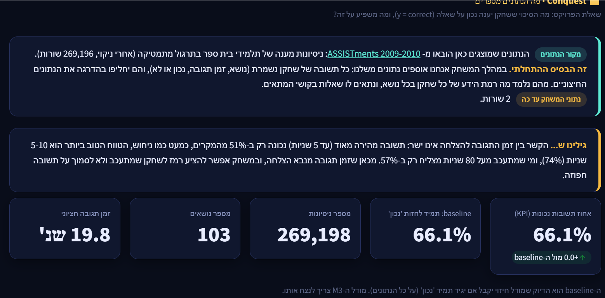
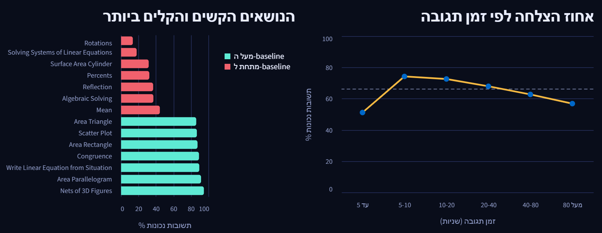
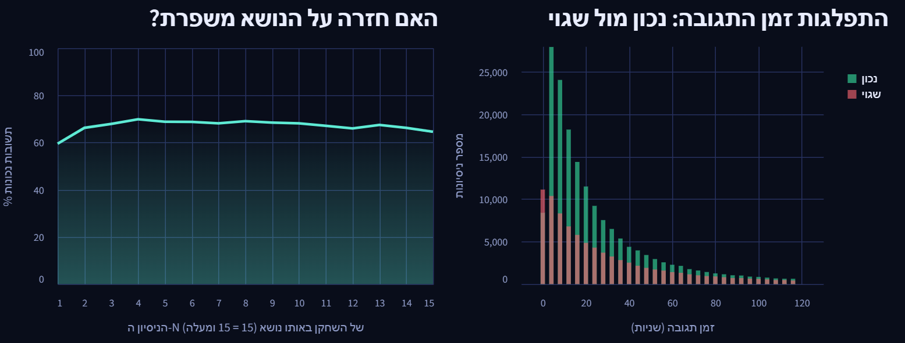
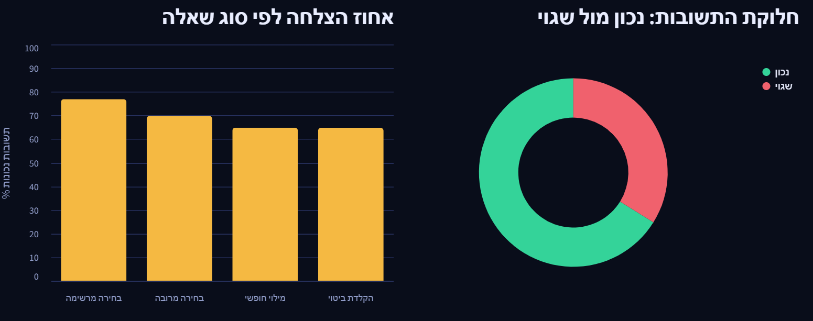
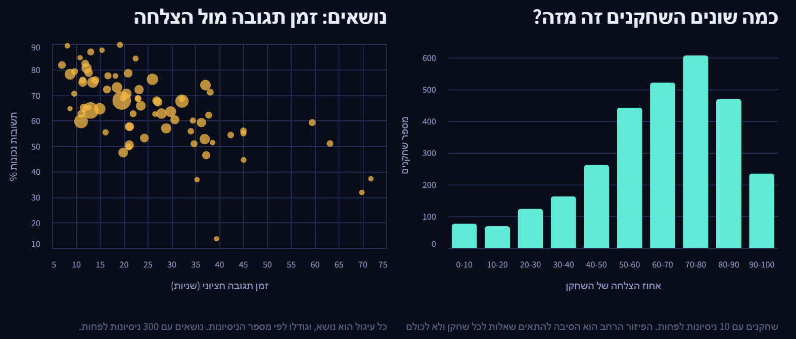
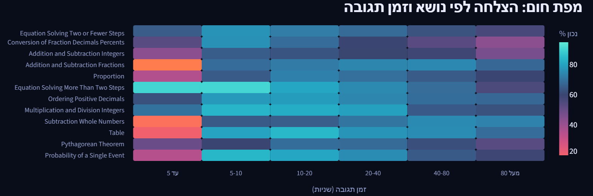
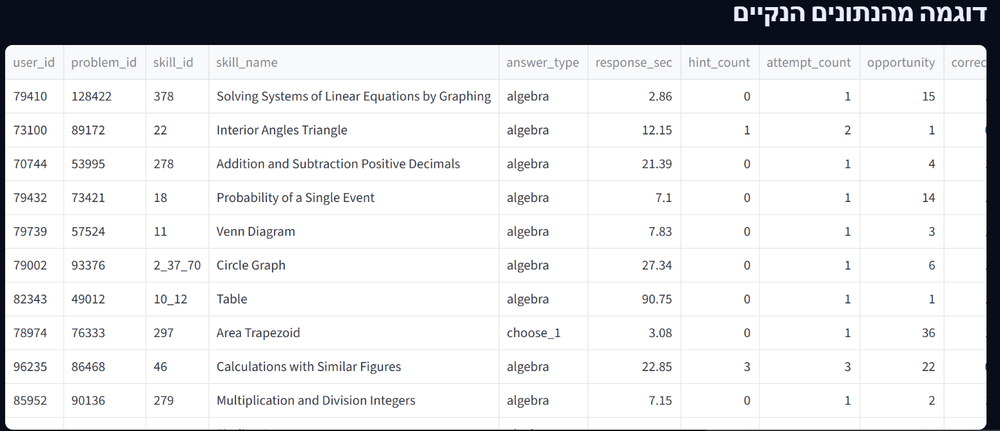

# Conquest – משחק אסטרטגיה ללמידה באמצעות כיבוש שטחים

**Learn. Compete. Conquer.**

## 1. תיאור הפרויקט במשפט אחד

סטודנטים מתקשים ללמוד באופן עצמאי ולשמור על מוטיבציה לאורך זמן. אנחנו מפתחים משחק אסטרטגיה תחרותי שבו סטודנטים מתחרים על כיבוש שטחים באמצעות ידע, כאשר מערכת AI מנתחת את חומרי הלימוד של הקורס ומייצרת מהם שאלות, תשובות ורמות קושי שונות.

## 2. הבעיה

למידה למבחנים דורשת תרגול חוזר, הבנה של החומר והתמדה לאורך זמן. סטודנטים רבים מתקשים לשמור על מוטיבציה כאשר הלמידה מתבצעת באופן עצמאי ובאמצעות סיכומים ושאלות רגילות. בנוסף, יצירת שאלות איכותיות מתוך חומרי הקורס דורשת זמן ומאמץ. אנחנו רוצים להפוך את הלמידה לחוויה משחקית, תחרותית ומותאמת לחומר שהסטודנטים באמת לומדים.

## 3. קהל היעד ותרחיש שימוש (Persona)

**קהל היעד:** סטודנטים המעוניינים ללמוד לקראת מבחנים יחד עם חבריהם לקורס, בדרך אינטראקטיבית ותחרותית.

**תרחיש שימוש:**

סטודנט נכנס לאפליקציה ובוחר את קבוצת הלימוד של הקורס שבו הוא רוצה לשחק, למשל "מבוא לאלגוריתמים". בתוך הקבוצה נמצאים חבריו לקורס, ומאגר חומרי הלימוד המשותף.

הסטודנטים מעלים לקבוצה מצגות, סיכומים וקובצי לימוד. מערכת ה-AI מנתחת את החומרים ומייצרת מהם שאלות בנושאים וברמות קושי שונות.

לאחר מכן, כל חברי הקבוצה משחקים על גבי מפה משותפת. כדי לכבוש שטח של שחקן אחר, צריך להתמודד עם אתגר לימודי ולענות נכון על השאלות. ככל שמצליחים יותר, ניתן להרחיב את השליטה במפה ולהתקדם במשחק.

## 4. מקור הנתונים (Data Source)

המערכת מבוססת על חומרי לימוד שמועלים על ידי המשתמשים לקבוצות הקורס.

**סוגי קבצים מתוכננים:**
- מצגות לימוד (PPT/PPTX).
- מסמכי PDF.
- סיכומים ומסמכי טקסט.

**המידע שיופק מהקבצים:**
- נושאים ותתי-נושאים בקורס.
- מושגים, הגדרות ועובדות מרכזיות.
- שאלות שנוצרו מתוך החומר.
- תשובות נכונות והסברים.
- רמות קושי וקטגוריות של שאלות.

**מבנה הנתונים:** המידע יעובד ויישמר במבנה מובנה, כך שכל שאלה תהיה מקושרת לקורס, לנושא, לתשובה הנכונה, להסבר ולרמת הקושי שלה.

**הערה לשלב M1:** בשלב זה מקור הנתונים העיקרי הוא קובצי הלימוד שהמשתמשים מעלים, ולכן אין עדיין מאגר טבלאי ציבורי קבוע עם מספר שורות ועמודות. נצטרך לבחור חומרי קורס לדוגמה לצורך בדיקת אבטיפוס ולהגדיר את מבנה הנתונים שנפיק מהם.

## 5. מה המשתמש יראה במסך הראשי?

במסך הכניסה המשתמש יוכל לבחור את קבוצת הלימוד של הקורס שבו הוא מעוניין לשחק.

לאחר הכניסה לקבוצה יוצגו:
- **מפת המשחק:** שטחים שניתן לכבוש, שטחים בבעלות השחקן ושטחים של שחקנים אחרים.
- **שחקני הקבוצה:** חברי הקורס וההתקדמות שלהם במשחק.
- **אפשרויות משחק:** תקיפה של שטח, הגנה על שטח או תרגול שאלות.
- **התקדמות לימודית:** נושאים שבהם השחקן הצליח ונושאים שכדאי לו לתרגל.

## 6. מה מודל ה-AI עושה?

בפרויקט שלנו, ה-AI משמש ליצירת תוכן לימודי מתוך חומרי הקורס. החל מ-M2 נוסף לכך ניתוח נתונים של תשובות תלמידים, שישמש ב-M3 לחיזוי הסיכוי של שחקן לענות נכון על שאלה (ראו סעיף 11).

**קלט למערכת:**
קובצי לימוד שהועלו לקבוצת הקורס, כגון מצגות, סיכומים ומסמכי PDF.

**תהליך עיבוד:**
1. חילוץ הטקסט והמידע מתוך קובצי הלימוד.
2. זיהוי הנושאים, תתי-הנושאים והמושגים המרכזיים.
3. יצירת שאלות המבוססות על החומר שהועלה.
4. יצירת תשובות נכונות והסברים לכל שאלה.
5. סיווג השאלות לפי נושא ורמת קושי: קלה, בינונית וקשה.
6. בדיקת התאמת השאלות והתשובות לחומר המקורי.

**פלט המערכת:**

מאגר שאלות מובנה עבור כל קבוצת לימוד, הכולל:
- נוסח השאלה.
- אפשרויות תשובה, כאשר מדובר בשאלה אמריקאית.
- התשובה הנכונה.
- הסבר לתשובה.
- הנושא שאליו השאלה שייכת.
- רמת הקושי.

המאגר ישמש את מנגנון המשחק ליצירת אתגרים לימודיים בהתאם לחומר הקורס.

## 7. User Stories – סיפורי משתמש

1. כסטודנט, אני רוצה לבחור קבוצת לימוד של קורס ולהצטרף אליה, כדי לשחק ולהתחרות עם חבריי לקורס.
2. כחבר בקבוצת לימוד, אני רוצה להעלות חומרי לימוד של הקורס, כדי שהמערכת תוכל לייצר מהם שאלות שישמשו את כל חברי הקבוצה.
3. כשחקן, אני רוצה לכבוש שטחים באמצעות מענה על שאלות ברמות קושי שונות, כדי להתקדם במשחק ובמקביל לתרגל את חומר הלימוד.

## 8. סיכונים ודרכי התמודדות

**סיכון 1 – איכות התוכן שנוצר על ידי ה-AI:** המערכת עלולה לייצר שאלות לא מדויקות או תשובות שגויות.

דרך התמודדות: לוודא שכל שאלה ותשובה מבוססות על חומר הלימוד המקורי, להציג הסבר ומקור בחומר, ולאפשר בדיקה ותיקון של שאלות בעייתיות.

**סיכון 2 – קושי בעיבוד חומרי לימוד:** קבצים שונים עשויים להכיל טבלאות, תמונות, נוסחאות או טקסט שאינו ניתן לחילוץ בקלות.

דרך התמודדות: להתחיל בתמיכה בקובצי PDF ומסמכי טקסט פשוטים, ולהרחיב בהמשך לסוגי קבצים נוספים.

**סיכון 3 – מורכבות המשחק:** שילוב של מערכת למידה, יצירת שאלות ומשחק אסטרטגיה עלול להפוך את המוצר למורכב מדי.

דרך התמודדות: להתחיל בגרסה בסיסית הכוללת קבוצת לימוד, מפה פשוטה, שאלות וכיבוש שטחים, ולהוסיף יכולות נוספות בהמשך.

## 9. חלוקת תפקידים בצוות

| חברת צוות | תפקיד | אחריות |
|---|---|---|
| אוריה שלמה | Product, Programmer | הגדרת המוצר, קהל היעד ואפיון חוויית המשתמש; פיתוח האפליקציה וניהול הקוד ב-GitHub |
| שירה גרינולד | AI/Data, UI/UX | עיבוד חומרי הלימוד, מאגר השאלות, הנתונים והדשבורד (M2); תכנון מסכי האפליקציה והמפה |

## 10. איך מריצים את הפרויקט?

דרישות: Python 3.9 ומעלה.

```bash
# 1. יצירת סביבה וירטואלית (מומלץ)
python -m venv venv

# 2. הפעלת הסביבה
# Windows (PowerShell):
venv\Scripts\Activate.ps1
# macOS / Linux:
source venv/bin/activate

# 3. התקנת התלויות
pip install -r requirements.txt

# 4. הרצת האפליקציה
streamlit run app.py
```

האפליקציה תיפתח בדפדפן בכתובת http://localhost:8501

**מה קיים כרגע (אבטיפוס):** משחק מקומי לשחקן יחיד מול 3 יריבי הדגמה מדומים. מפת עולם אינטראקטיבית של 16 שטחים (בעלי שכנים אמיתיים), שאלות לדוגמה מהקובץ `data/questions.json` (מבוא למדעי המחשב), כיבוש שטחים בתשובות נכונות, דירוג וסיום משחק. המפה מחולקת ל-8 "אזורי ידע" – כל אזור הוא נושא בקורס, והשטחים בו שואלים רק על הנושא שלו (שליטה באזור שלם נותנת בונוס). אפשר לתקוף רק שטח שגובל בשטח שלך, וכשיריב הדגמה תוקף שטח שלך עונים על שאלת הגנה כדי לשמור עליו. העלאת קבצים ויצירת שאלות באמצעות AI עדיין לא מומשו.

## 11. נתונים ומחברת EDA (M2)

**הבעיה:** כדי שהמשחק יהיה מאתגר ולא מתסכל, צריך להתאים שאלות לכל שחקן. לכן אנחנו שואלים: **מה הסיכוי ששחקן יענה נכון על שאלה, ומה משפיע על זה?** ב-M3 נבנה מודל שמנבא את זה, ובהמשך נשתמש בו כדי להתאים את הקושי לשחקן ולהציע נושאים לתרגול.

**ה-y:** `correct` (1 = ענה נכון בניסיון הראשון, 0 = שגוי). משתנה בינארי, כלומר סיווג.

**המחברת:** [eda.ipynb](eda.ipynb) היא ההגשה של M2. היא עונה על ארבע השאלות (סוגי עמודות, איכות, התפלגויות, קשר ל-y כולל בדיקת דליפה), עם מסקנה מתחת לכל גרף, ומסתיימת בבדיקת סיגנל, תובנה ו-baseline. היא שמורה עם הפלט, כך שאפשר לקרוא אותה גם בלי להריץ.

**הרצה:**
```bash
pip install -r requirements.txt
jupyter lab eda.ipynb          # או: jupyter nbconvert --to notebook --execute --inplace eda.ipynb
```

**דשבורד (בנוסף, לא נדרש):** `streamlit run dashboard.py` מציג את אותם נתונים באופן אינטראקטיבי, ומצרף את נתוני המשחק (`data/attempts.jsonl`) אם הם קיימים.

### Data Card

| שדה | פירוט |
|---|---|
| מקור וקישור | [ASSISTments 2009-2010 Skill Builder Data](https://sites.google.com/site/assistmentsdata/home/2009-2010-assistment-data/skill-builder-data-2009-2010), הגרסה המתוקנת (ללא כפילויות רשומות). נתוני שימוש של תלמידי בית ספר במערכת ASSISTments בשנים 2009-2010 |
| קובץ להורדה | [skill_builder_data_corrected.csv](https://drive.google.com/file/d/1NNXHFRxcArrU0ZJSb9BIL56vmUt5FhlE/view?usp=sharing) (64MB, לא נשמר בריפו) |
| גודל ופורמט | מקור: 346,860 שורות ו-31 עמודות, CSV. אחרי ניקוי: **269,196 שורות ו-10 עמודות** ב-`data/assistments_clean.csv` (17.6MB) |
| משתנה היעד (y) | `correct`: האם התלמיד ענה נכון בניסיון הראשון (1 = נכון, 0 = שגוי). קטגוריה בינארית, סיווג |
| חוסרים ובעיות | ראו "מה תיקנו ולמה" |
| רישיון והטיות | האתר מבקש לצטט את הדף שלו ומפנה לדף Terms of Use שלו; **יש לקרוא אותו לפני פרסום**. הנתונים מייצגים תלמידי בית ספר שפתרו שאלות מתמטיקה באנגלית בארה"ב, ולא סטודנטים למדעי המחשב בעברית. לכן המודל ילמד דפוסי מענה כלליים (זמן תגובה, נושא, חזרה) ולא תוכן של שאלות שלנו |

**עמודות אחרי ניקוי:** `user_id`, `problem_id`, `skill_id`, `skill_name` (הנושא), `answer_type`, `response_sec` (זמן תגובה ראשון בשניות), `hint_count`, `attempt_count`, `opportunity` (הניסיון ה-N של התלמיד באותו נושא), `correct`.

### מה תיקנו ולמה

הסקריפט `data_prep.py` מבצע את הניקוי ומדפיס את המספרים (`python data_prep.py <קובץ מקורי>`).

| צעד | שורות שנמחקו | סיבה |
|---|---|---|
| שורות ללא נושא (`skill_id`/`skill_name` חסרים) | 72,270 | אי אפשר לנתח לפי נושא, והמשחק שלנו עובד לפי נושאים. לא מילאנו ערך, כי נושא שמנחשים יזייף את התוצאות |
| זמן תגובה אפס או שלילי | 315 | זמן שלילי הוא ערך לא אפשרי (שגיאת רישום) |
| זמן תגובה מעל 10 דקות | 1,040 | כנראה תלמיד שנטש את המסך, ולא זמן מענה אמיתי |
| אותו תלמיד ואותה שאלה יותר מפעם אחת | 4,039 | נשמר רק הניסיון הראשון, כי היעד הוא ההצלחה בניסיון הראשון. זה לא כפילות רשומה, שכן הגרסה המתוקנת כבר ללא כאלה |

עוד: `skill_name` נוקה מרווחים, זמן התגובה הומר משניות ל-`response_sec`, והעמודות שלא משמשות את הניתוח הוסרו (כגון מזהי כיתה ובית ספר). עמודות עם חוסרים רבים שאינן בשימוש (`answer_id`, `bottom_hint`) לא נשמרו.

**זהירות, דליפת מידע (leakage):** `hint_count` ו-`attempt_count` נקבעים רק אחרי התשובה. תלמיד שביקש רמז נרשם כמי שטעה (כמעט תמיד `correct=0`), ולכן אסור להשתמש בהם כקלט למודל החיזוי ב-M3.

### תובנות

1. **הקשר בין זמן תגובה להצלחה אינו ישר:** תשובה מהירה מאוד (עד 5 שניות) נכונה רק ב-51% מהמקרים, הטווח הטוב ביותר הוא 5-10 שניות (74%), ומעל 80 שניות ההצלחה יורדת ל-57%.
2. **הנושאים שונים מאוד בקושי:** מ-45% הצלחה בנושא הקשה ביותר (`Mean`) ועד כ-90% בקלים ביותר, בנושאים עם לפחות 500 ניסיונות.
3. **חזרה על נושא עוזרת בהתחלה:** הניסיון הראשון בנושא נכון ב-59.5%, ההצלחה עולה עד 69.4% בניסיונות 4-5, ואחר כך יורדת ל-64.1% אחרי יותר מ-20 ניסיונות. כלומר הקשר אינו ישר.

**baseline:** 66.1% (תמיד לחזות "נכון", הקטגוריה הנפוצה). מודל ה-M3 צריך לנצח את המספר הזה.

### נתוני המשחק

המשחק עצמו שומר כל תשובה אמיתית ב-`data/attempts.jsonl` (קובץ מקומי, לא בריפו). אם הקובץ קיים, הדשבורד מצרף אותו אוטומטית כמקור "Conquest (המשחק)", וכשיצטברו מספיק משחקים אפשר לסנן ולהשוות אותו לנתוני ASSISTments. כרגע יש בו מעט מאוד שורות, ולכן הוא לא משמש כמקור ראשי.

### צילומי מסך של הדשבורד

מקור הנתונים, התובנה והמדדים (כולל ה-baseline):



הצלחה לפי זמן תגובה, והנושאים הקשים והקלים:



התפלגות זמן התגובה, והשפעת חזרה על הנושא:



חלוקת התשובות, והצלחה לפי סוג שאלה:



השוני בין שחקנים, והקשר בין זמן התגובה להצלחה בכל נושא:



מפת חום של הצלחה לפי נושא וזמן תגובה:



דוגמה מהנתונים הנקיים:



## 12. פיתוח עתידי

בהמשך נרצה להרחיב את המערכת באמצעות :
- אפשרות לפתיחת קבוצות לימוד והזמנת חברים.
- העלאת מספר חומרי לימוד לאותו קורס.
- יצירת מאגר שאלות שמתעדכן בהתאם לחומרים החדשים.
- התאמת רמת השאלות להתקדמות השחקן.
- משחקי תקיפה והגנה בין חברי הקבוצה.
- מפות, דירוגים ואתגרים קבוצתיים.
